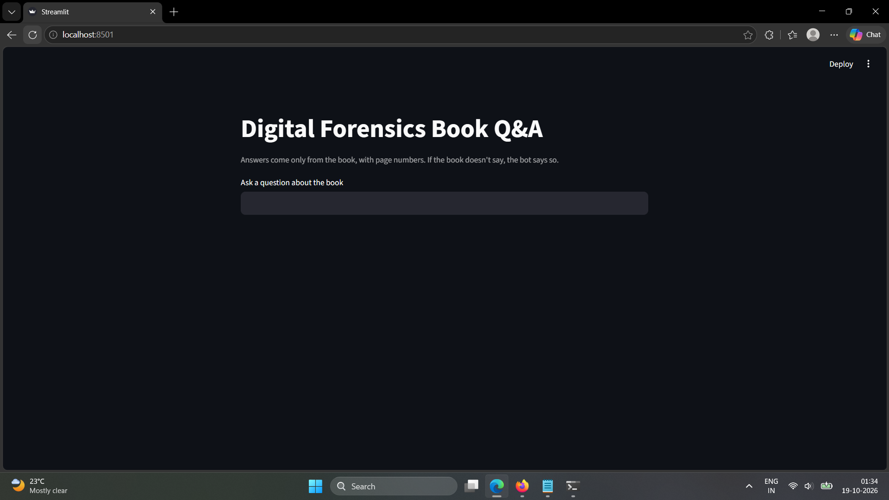
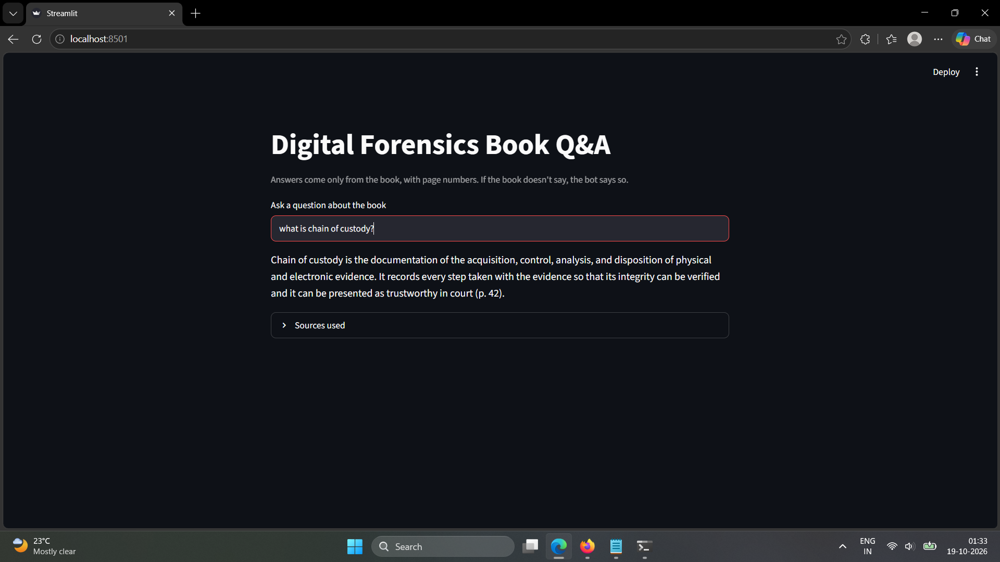
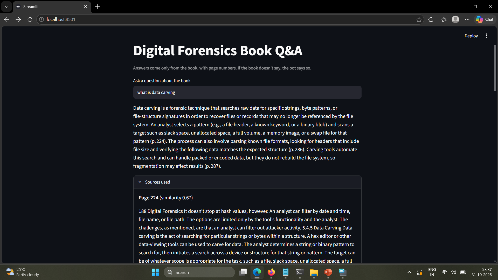
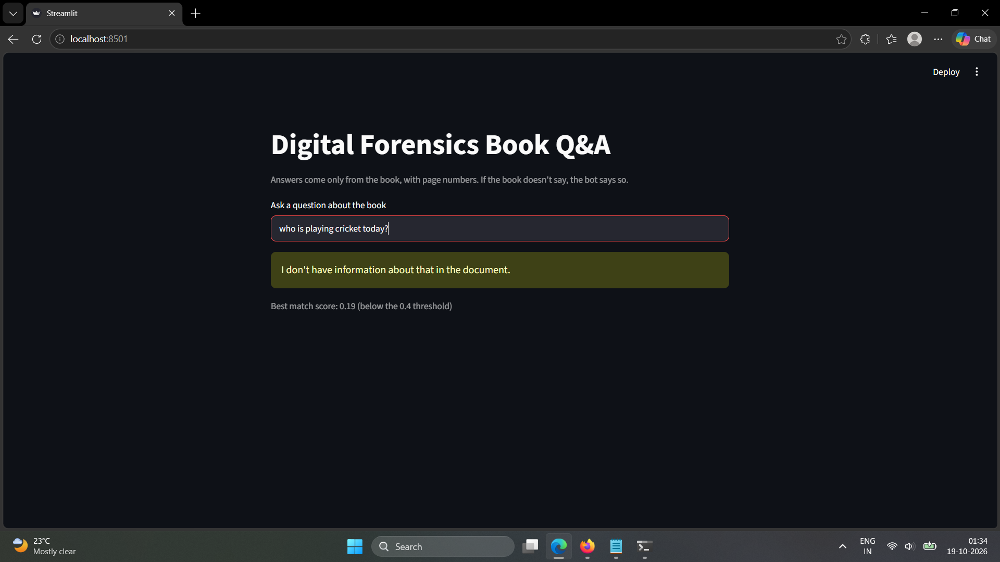
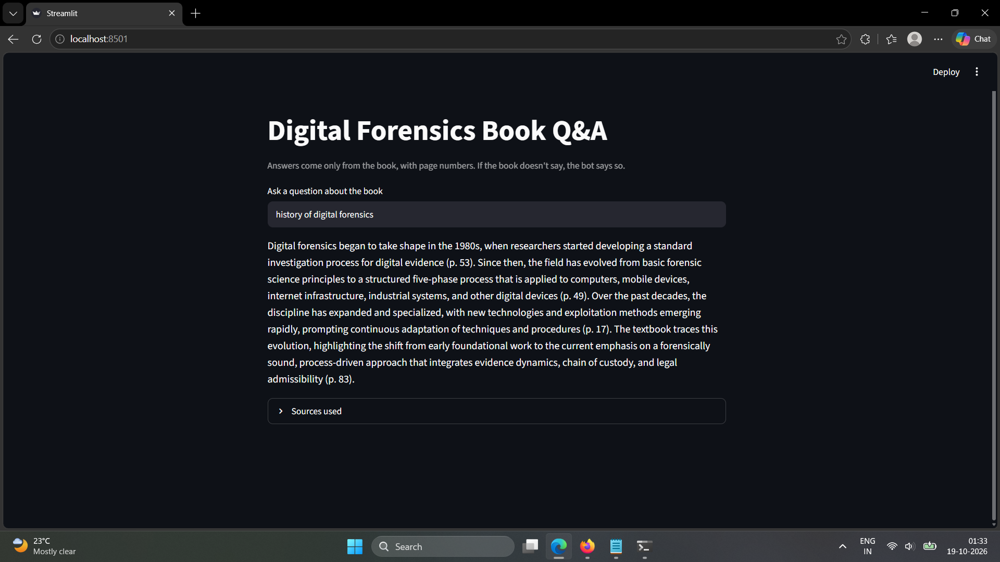

# Digital Forensics Book Q&A

A question-answering chatbot built with RAG (retrieval-augmented generation). It answers questions about a 373-page digital forensics textbook, shows the page numbers it used, and says so when the book doesn't contain the answer.

I built it to understand how RAG works from start to finish: splitting a PDF, embedding it, searching it, and making an LLM answer only from what was retrieved. I also wrote a small test set to measure how well it works and to find where it breaks.

> The textbook is **not included** in this repository (it is copyrighted). To run the project you need to supply your own PDF. See [Run it yourself](#run-it-yourself).

## Screenshots

| | |
|---|---|
| Home page |  |
| An answer with page citations |  |
| "Sources used" shows the passages behind the answer |  |
| A question the book doesn't cover is refused |  |
| A known weak spot (see [Limitations](#known-limitations)) |  |

## How it works

```
Preparing the library (done once)
  PDF -> split into chunks (800 characters, 150 overlap, page number kept)
      -> embed each chunk (all-MiniLM-L6-v2)
      -> store in ChromaDB

Answering a question
  question -> embed -> find the 8 most similar chunks
           -> if the best similarity is below 0.40: refuse
           -> otherwise send the chunks and the question to the LLM
              with rules: use only these excerpts, cite pages,
              say "not enough information" if the answer isn't there
           -> show the answer and the source passages
```

A few design choices:

- **Chunk overlap** (150 characters) so a sentence cut at the end of one chunk still appears whole in the next.
- **Two layers of refusal.** A similarity threshold (0.40) catches clearly unrelated questions without calling the LLM. The prompt rule catches questions that sound related but aren't answered in the text.
- **Temperature 0** so answers are as stable as possible.
- **Page numbers stored with every chunk**, so each answer can be checked against the PDF.

## Tech stack

Python, `pypdf` (reading the PDF), `sentence-transformers` with `all-MiniLM-L6-v2` (embeddings), ChromaDB (vector database), Groq API with `openai/gpt-oss-20b` (the LLM), Streamlit (web page), `rank_bm25` (one experiment, see below).

## Evaluation

`questions.json` holds 15 test questions:

| Type | Count | What it tests |
|---|---|---|
| Answer is in one place | 6 | Basic retrieval and answering |
| Answer needs several passages | 4 | Whether the right pieces are pulled together |
| Not in the book | 5 | Whether the bot refuses instead of making things up. Three of them sound related to the topic (for example, "How do I recover deleted files on a PlayStation?"). |

Expected pages were chosen from the table of contents and checked against the PDF. An answerable question **passes** if the bot answered and at least one expected page was among the retrieved chunks. A not-in-the-book question **passes** if the bot refused. `eval_rag.py` runs all 15 and prints the results.

### Results

| Setup | Answered correctly (of 10) | Retrieval hit (of 10) | Correct refusals (of 5) |
|---|---|---|---|
| Embeddings only, top-4 chunks | 8 | 9 | 5 |
| Embeddings only, top-8 chunks | 9 | 9 | 5 |
| Hybrid (embeddings + keyword search), top-8 | 9 | 9 | 5 |

### What the experiments showed

**Retrieving more chunks helped.** With 4 chunks, the question about how cryptographic hashes support evidence integrity and chain of custody failed. The retrieved pages were all about chain of custody and none explained hashes, so the bot refused rather than guess. With 8 chunks it passed. The cost is about twice as much text sent to the model for each question.

**Hybrid search gave no gain on this test set.** I added BM25 keyword search and combined it with the embedding search (reciprocal rank fusion). The score stayed at 9 of 10 and nothing broke. With only 15 questions, this means "no gain here", not "doesn't work".

**Q9 is a case study in how the automatic check can mislead.** The question asks which methods can be used to physically acquire data from mobile devices (chip-off, JTAG). It fails the page check in all three setups, because the expected pages (252, 258, 259) are the detailed sections on chip-off and JTAG. Those detailed pages rank 31st to 102nd out of 1,579 chunks for this question, because the small embedding model matches general overview text better than technical detail. But the pages the search did return (244, 250, 260, 276) are overviews, and page 244 lists all five methods in one place (manual extraction, logical extraction, hex dumping/JTAG, chip-off, micro read). The hybrid-search answer is built on that page and reads correctly. So the expected pages were too narrow, and a page-match check is only a rough proxy for a correct answer. I left the test unchanged rather than editing it after seeing the results.

**Refusals needed both layers.** All five out-of-book questions were refused, but not always by the threshold. The PlayStation question scored 0.39, just under the 0.40 threshold. The question about computer fraud sentences in India scored 0.54 and passed the threshold, so it was the prompt rule that made the bot refuse. Neither layer alone would be enough.

## Known limitations

- **Broad questions can produce padded answers.** For "history of digital forensics", the bot wrote a fluent answer from loosely related passages, including a sentence about what "the textbook traces" that the book doesn't say, and cited pages that don't discuss history. See the last screenshot.
- **Citations are not always exact.** Spot-checks of several answers against the PDF found small slips: a claim cited to the wrong page, a closing sentence with no support in its cited page, and a dropped qualifier ("in some jurisdictions").
- **A high similarity score means the topic is close, not that the answer is present.**
- **Chunks are cut at fixed lengths**, so they can start or end mid-sentence and can include the book's page headers.
- **Answers vary slightly between runs**, even at temperature 0.
- **The test set is small (15 questions)**, the threshold was tuned on only a handful of examples, and the pass/fail check does not judge whether an answer is correct.
- **It uses a hosted free-tier model**, so do not use it with confidential documents.

## Ideas for improvement

- Remove page headers and footers, and split on sentences or paragraphs instead of a fixed length.
- Try a larger embedding model or add a re-ranking step.
- Add an automatic faithfulness check (does every sentence of the answer appear in the cited pages?) and a bigger test set.
- Break multi-part questions into sub-questions before searching.

## Run it yourself

Tested on Windows with PowerShell.

```powershell
git clone https://github.com/riya-bajaj1/llm-learning.git
cd llm-learning
python -m venv venv
venv\Scripts\Activate.ps1
pip install -r requirements.txt
```

1. Put a PDF with real text (not scanned images) in the folder and name it `docs.pdf`.
2. Split and embed it (once):
   ```powershell
   python chunk_pdf.py
   python embed_chunks.py
   ```
3. Get a free API key from [console.groq.com](https://console.groq.com) and set it for this terminal session. Never commit it to the repository.
   ```powershell
   $env:GROQ_API_KEY = "your-key-here"
   ```
4. Start the web page:
   ```powershell
   streamlit run app.py
   ```
   If the terminal fills with errors about `torchvision`, run `streamlit run app.py --server.fileWatcherType none` instead.
5. To run the evaluation, write your own questions in `questions.json` (the ones in the repo are for the original textbook), then run `python eval_rag.py`.

## Project structure

| File | Purpose |
|---|---|
| `chunk_pdf.py` | Reads `docs.pdf` and splits it into chunks with page numbers |
| `embed_chunks.py` | Embeds the chunks and stores them in ChromaDB |
| `retrieve.py` | Command-line search that shows the best chunks with scores |
| `rag_chat.py` | Command-line chatbot (retrieval plus LLM answer) |
| `app.py` | Streamlit web page |
| `questions.json` | The 15 test questions with expected pages |
| `eval_rag.py` | Runs the test set against the embedding-only search |
| `eval_hybrid.py` | Runs the test set against the hybrid search |
| `rank_q9.py` | Shows where specific pages rank for the Q9 question |
| `practice/` | Early practice scripts: first API call, chatbot with memory, JSON output and validation, embeddings |

The PDF, the chunk file, the vector database, and the result files are listed in `.gitignore` because they contain text from the book.
